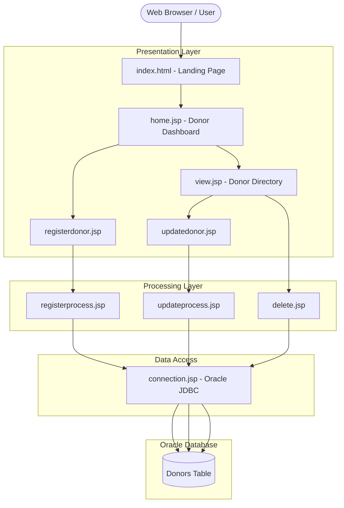

<p align="center">
  
</p>

# 🩸 Blood Donation Management System

[](https://github.com/sadmandied/BloodDonationManagement/actions)
[](https://opensource.org/licenses/MIT)
[](https://www.oracle.com/java/)
[](https://tomcat.apache.org/)
[](https://www.oracle.com/database/)

A Java-based web application developed using **JSP Scriptlets**, **JDBC**, and **Oracle Database XE** to streamline voluntary blood donor registration, blood group queries, and record management.

---

## 🌟 Overview
The **Blood Donation Management System** simplifies blood bank and donor operations. It enables healthcare coordinators and blood banks to manage active donors, search for compatible blood types, update donor availability, and maintain emergency contact channels.

Developed in **Apache NetBeans** with pure JSP scriptlets and Oracle Database connectivity.

---

## 🏛️ System Architecture



---

## ⚙️ Key Features
- 🩸 **Comprehensive Donor Registration:** Capture name, blood group (A+, A-, B+, B-, AB+, AB-, O+, O-), age, location, and contact phone.
- 📋 **Live Donor Directory:** View all registered donors with their real-time availability status.
- ✏️ **Edit & Update Donors:** Modify location, contact details, or toggle availability between `Available` and `Unavailable`.
- 🗑️ **Record Management:** Safely remove inactive or outdated donor entries.
- 🗄️ **Oracle Database Integration:** Reliable data storage powered by Oracle XE and JDBC `PreparedStatement`.

---

## 📸 Screenshots

<p align="center">
  
  
  
  
</p>

---

## 🗄️ Database Schema

The system uses the `Donors` table in Oracle:

```sql
CREATE TABLE Donors (
    donor_id NUMBER PRIMARY KEY,
    name VARCHAR2(100) NOT NULL,
    blood_type VARCHAR2(10) NOT NULL CHECK (blood_type IN ('A+', 'A-', 'B+', 'B-', 'AB+', 'AB-', 'O+', 'O-')),
    age NUMBER(3) NOT NULL,
    location VARCHAR2(100) NOT NULL,
    contact_info VARCHAR2(50) NOT NULL,
    availability VARCHAR2(20) DEFAULT 'Available' CHECK (availability IN ('Available', 'Unavailable'))
);
```

*A ready-to-run DDL and seed data script is provided in [`schema.sql`](./schema.sql).*

---

## 🚀 Setup & Execution

1. **Prerequisites:**
   - JDK 8 or higher
   - Apache Tomcat 9/10
   - Oracle Database XE 11g+
   - Apache NetBeans IDE
2. **Database Setup:**
   - Run `schema.sql` in Oracle SQL Commands or SQL*Plus under user `PROJECT` (or update credentials in `web/connection.jsp`).
3. **Deploy & Run:**
   - Open project in NetBeans, set server to Tomcat, and run.

---

## 📜 License

This project is licensed under the [MIT License](./LICENSE).

---

## 👤 Author

- **Sadman Fahmid Raj**
- University of Scholars
